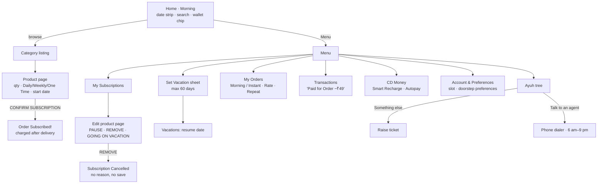

# Current-State Analysis

The full screen-by-screen audit is in [`../01_Research_and_Discovery/Application_Audit.md`](../01_Research_and_Discovery/Application_Audit.md). This page summarises the current customer journey and where effort concentrates.

## 1. Current-state journey map (observed)

## 2. Steps to complete common tasks today (counted from the recording)

| Task | Path observed | Taps (approx.) | Decision points | Notes |
|---|---|---|---|---|
| Add a new daily milk subscription | Home → category → product → qty → CONFIRM | 4–5 | 3 (product, qty, frequency/date) | Works well; praised (P05) |
| Increase quantity of an existing subscription | Menu → My Subscriptions → EDIT → stepper → CONFIRM | 5 | 1 | Consequences (offer, price) not previewed |
| Pause for a week | Menu → Set Vacation → start → end → CONFIRM | 5 | 2 | Calendar only; rule "Max 60 days" |
| Understand a deduction | Menu → Transactions → read row → (no link) → Ayuh → Recharges → … → ticket/call | 7+ | Many | Dead end (F-01) |
| Report "marked delivered, not received" | Menu → Ayuh → … → ticket/call (or FAQ path) | 6+ | Many | No order-card action (F-05) |
| Turn off doorbell / ask to call before delivery | Menu → Account & Preferences → toggle | 3 | 1 | Easy but undiscovered (F-11) |
| Find high-protein products | Products/Groceries → Pick Your Health Goal → High Protein | 3 | 1 | No allergy filter (F-14) |

## 3. Where effort and risk concentrate

1. **Money comprehension** (F-01, F-02, F-03, F-12, F-15).
2. **Morning exceptions** (F-04, F-05, F-06, F-11).
3. **Subscription change confidence** (F-08, F-09, F-10).
4. **Help that routes instead of resolves** (F-07, F-17).
5. **Outreach frequency** (F-13), a governance risk for UC4.

## 4. What works and must be preserved

Product quality and the morning ritual (P01, P02); a clear subscription creation flow (A8–A9); "charged after delivery" (EV-017); vacation empty-state policy copy (EV-021); 70% public review replies (EV-058); test reports (EV-032); health-goal merchandising (EV-036).
