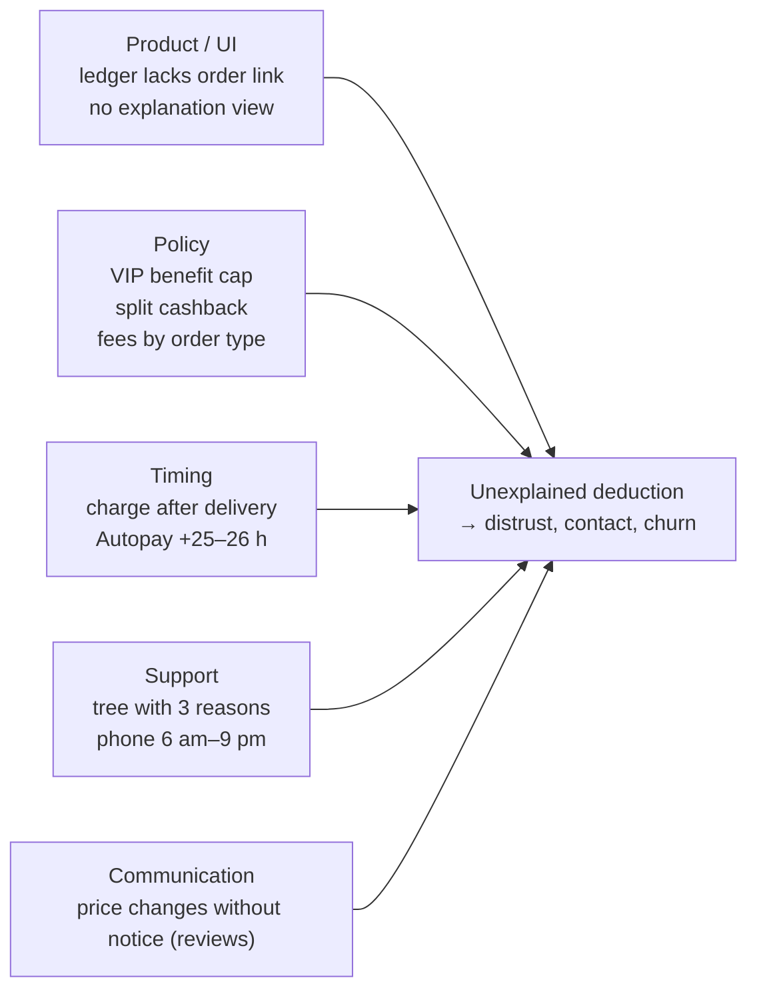

# Root Cause Analysis

Method: journey friction analysis on the recorded app (S3), Five Whys and fishbone for the five highest-severity friction points in [`Friction_Register.xlsx`](Friction_Register.xlsx), and a service blueprint for the pre-dawn delivery window. **Rule applied throughout:** where evidence establishes only a symptom, the cause is written as a *hypothesis* and paired with the data that would confirm it. Nothing here is a statement about Country Delight's internal systems.

## 1. F-01 — "Why was money deducted?" (Severity 5)

**Symptom (VERIFIED):** wallet/deduction/refund themes in 16.7% of Play and 27.5% of App Store negative reviews (EV-056/057); language of "fraud" and "loot".

**Five Whys**

1. *Why do customers believe money was taken wrongly?* They see a balance change they cannot connect to a delivery they remember. (Reviews, EV-067)
2. *Why can't they connect it?* The ledger row says "Paid for Order −₹49, closing balance ₹112" with no product, order or date link (OBSERVED, EV-026).
3. *Why is the link missing at the moment of doubt?* Money moves through several mechanisms on different clocks: charge after delivery (EV-017), Autopay 25–26 h after trigger (EV-009), cashback split over future transactions (EV-031), VIP benefit consumption separate from the wallet (EV-010), convenience/handling fees (EV-017, reviews). **HYPOTHESIS:** the UI presents the ledger as a list, not as explanations.
4. *Why doesn't help close the gap?* Ayuh's "Recharges" branch offers three fixed reasons, then ticket or phone (EV-033); phone is 6 am–9 pm (EV-002).
5. *Why does this become churn?* A customer who suspects money loss reduces trust in a prepaid model, where trust *is* the product. **HYPOTHESIS**, to confirm with cohort data (wallet-dispute contact → churn within 30 days).

**Fishbone**

**Intervention (PROPOSED, UC1):** "Explain this transaction": retrieve the ledger line, join it to the order/plan/rule, explain in one sentence, show the source line, offer the next step (dispute → ticket with the line attached). **Read-only**: lowest risk, highest frequency.

**Validation:** share of contacts tagged wallet/deduction; ledger API fields; dispute outcomes (how many were correct charges vs errors).

## 2. F-04 / F-05 — Delivery problems in the pre-dawn window (Severity 5)

**Symptom (VERIFIED):** delivery reliability plus marked-delivered complaints (N06, understated) and support-access complaints (N09); reviews state there is "no way… to get your delivery related issues sorted the same day".

**Service blueprint (pre-dawn morning)**

| Time | Customer | Front stage (app / Ayuh / phone) | Back stage (inferred, HYPOTHESIS) | Gap |
|---|---|---|---|---|
| 23:00 | Last change before cut-off (EV-007) | App | Route & pick lists frozen | — |
| 04:00–05:00 | Asleep | — | Dispatch; stockouts surface | Stockout swaps would need consent in advance |
| 05:00–07:30 | Bell / doorstep (N07) | Delivered status in My Orders (EV-025) | Rider marks delivered (photo/GPS per reviews) | Status may say delivered before the customer sees it |
| 05:30 | Notices missing milk | Ayuh tree → ticket or "Call Us" | Support not staffed until 06:00 (EV-002) | **No live channel for up to 60 min** |
| 06:00–09:00 | Calls | Phone queue at peak | Investigation needs rider and POD | Slow, repeat contacts |
| +24–48 h | Waits | Email/ticket | — | Feels unresolved |

**Five Whys (marked delivered but not received)**

1. *Why is the customer angry?* The app says delivered; they have nothing. (EV-069)
2. *Why can't they resolve it at once?* Self-service ends in a ticket or a call; support opens at 6 am (EV-002, EV-033).
3. *Why can't first-line support answer quickly?* **HYPOTHESIS:** proof-of-delivery evidence (photo/GPS/rider) is not available to the first responder in real time.
4. *Why is the outcome slow?* **HYPOTHESIS:** remedies (re-delivery, credit) require manual approval.
5. *Why does it repeat?* No closed loop from complaint to rider/route quality. (HYPOTHESIS)

**Intervention (PROPOSED, UC2):** a 24×7 agent that (1) verifies identity, (2) reads status and POD, (3) explains what is known, (4) applies **only** CD-approved remedies within thresholds, (5) creates a ticket with evidence and a case ID, (6) books a callback for when humans start. Optional opt-in WhatsApp exception alerts (A4), **never pre-dawn voice**.

## 3. F-08 — Subscription changes feel risky (Severity 4)

**Symptom:** subscription/vacation/schedule control in 13–16% of negatives, while flexibility is also praised (P05). Customers fear unintended outcomes: items added "on its own", skips that skip two days, offers voided.

**Causal chain (OBSERVED → HYPOTHESIS)**
- Edit, pause, remove and vacation are on three surfaces (EV-022, EV-023, EV-019). OBSERVED.
- Consequences are not previewed at change time: offer voiding (EV-011), price per pack vs total (A5), next delivery affected. OBSERVED for offers; HYPOTHESIS for the rest.
- App updates changed behaviour (calendar view removed, vacation end date) without notice (reviews). HYPOTHESIS on frequency.

**Intervention (PROPOSED, UC5):** intent-level change card. Current → proposed, effective date, price impact, offer impact; **Confirm** and **Undo**; the agent never changes a subscription without explicit confirmation.

## 4. F-07 — Help that cannot act (Severity 4)

Ayuh routes but does not understand free text or execute tasks (EV-033); reviewers call bots loops (N09). **Root cause (OBSERVED design):** a decision tree cannot cover the long tail and cannot hand off context. **Intervention:** Graine as the "understand-and-act" layer behind Ayuh's "Something else" and as a global Ask entry; warm handoff with a summary to a human (PR-001).

## 5. F-12 / F-13 — Offers and outreach (Severity 4)

**Offer clarity:** terms exist but are disclosed away from decision time (EV-010, EV-011). **Outreach:** repeated calls are a complaint today (EV-068). **Root cause (HYPOTHESIS):** campaign execution optimised for reach without per-customer frequency caps. **Intervention:** UC4 only within consent, caps, DNC and AI disclosure, with offer facts drawn from the offer record. Prefer in-app and opted-in WhatsApp over cold calls.

## 6. What is *not* a root cause we can claim

- We cannot claim the wallet charges are wrong. Our evidence is that they are **unexplained**.
- We cannot claim support is understaffed. Our evidence is **hours and channel limits**.
- We cannot attribute quality complaints to any cause. They are routed to CD's quality team (A5), not "solved" by AI.
