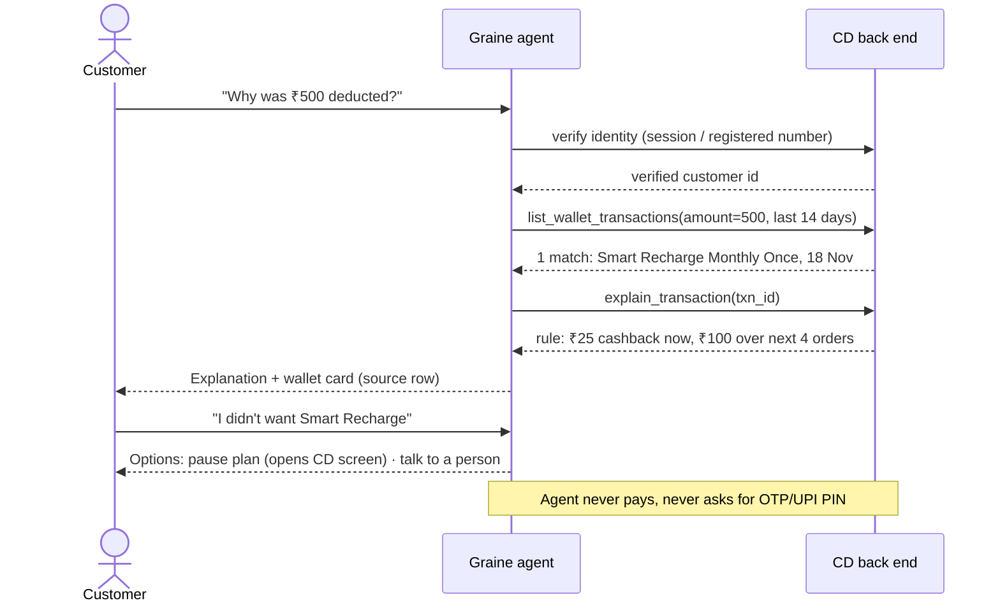
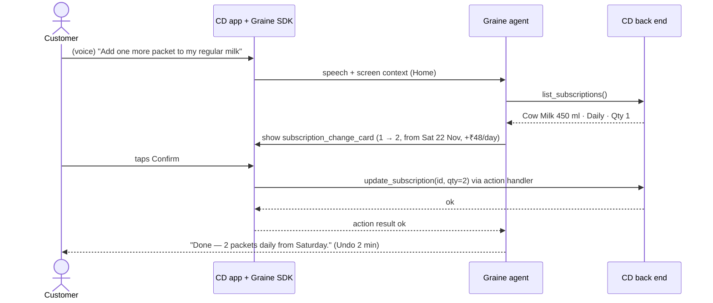
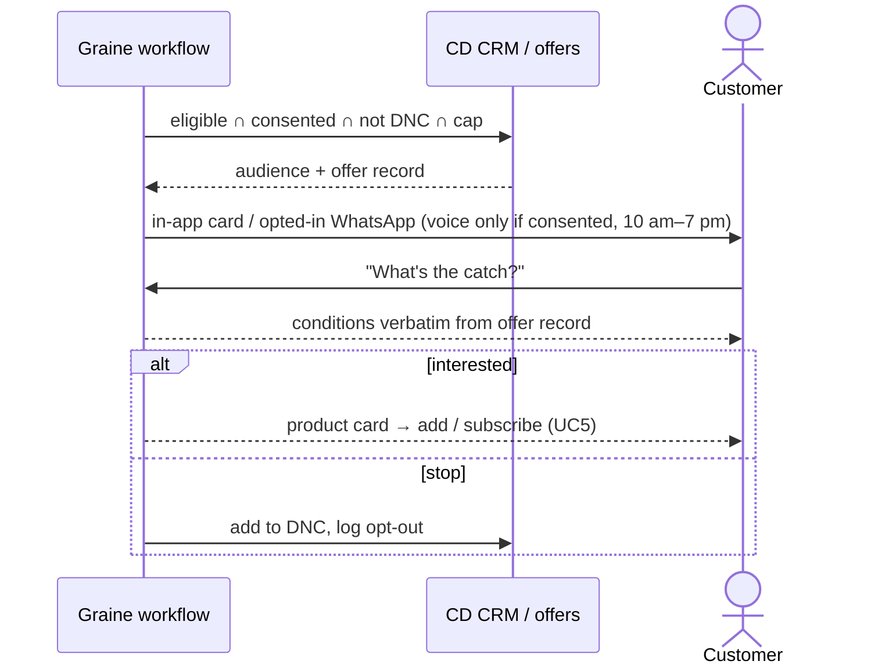

# Journey Maps — Sequence Diagrams

Mermaid diagrams (render on GitHub). Each shows who does what, where confirmation sits, and where a failure goes. Tool names are the proposed contract from [Enhanced_Journey.md](../Enhanced_Journey.md).

## UC1 · Explain a deduction (WhatsApp or in-app)



## UC2 · Milk not arrived (5:40 AM)

```mermaid
sequenceDiagram
  actor C as Customer
  participant G as Graine agent
  participant CD as CD back end
  participant H as CD support (from 6 AM)
  C->>G: "Mera doodh abhi tak nahi aaya"
  G->>CD: get_todays_delivery()
  alt status = out for delivery
    CD-->>G: ETA window
    G-->>C: Status card + "I'll message you if it's late"
  else status = delivered
    CD-->>G: delivered 05:12, POD photo
    G-->>C: "Marked delivered at 5:12. Is anything at the door or gate?"
    C->>G: "Nothing"
    G->>CD: request_resolution(reason=not_received)
    CD-->>G: eligible: re-delivery by 9 AM | wallet credit
    G-->>C: Options card
    C->>G: Confirms re-delivery
    G->>CD: create_support_ticket + resolution
    CD-->>G: case CD-2611-0042
    G-->>C: Confirmation with case id
  else API unavailable
    G->>CD: create_support_ticket(callback 06:00)
    G-->>C: "I can't see the status right now; a person will call after 6 AM"
  end
  G->>H: ticket with transcript summary
```

## UC3/UC5 · Change a subscription with a component



## UC4 · Consent-first offer conversation



## UC6 · Wellness onboarding

```mermaid
sequenceDiagram
  actor C as Customer
  participant G as Graine agent
  participant CD as CD catalogue
  C->>G: "I've started working out; recommend products"
  G-->>C: consent to remember goals & allergies? (skip allowed)
  G-->>C: goal / diet / allergy quick replies
  C->>G: High protein · Vegetarian · Peanut allergy
  G->>CD: recommend_products(tags=[high_protein, veg], exclude_allergens=[peanut])
  CD-->>G: SKUs with attributes
  G-->>C: product cards with "why" + "not medical advice"
  C->>G: "Add the paneer and protein milk"
  G->>CD: add_to_cart
```
