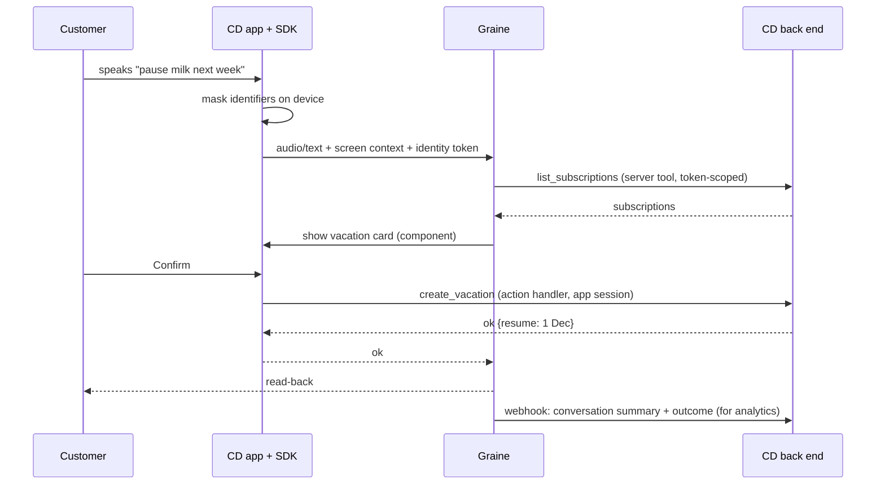

# Data Flow

## 1. What moves where

| Data | Origin | Leaves device? | Masked | Reaches model? | Stored by Graine | Stored by CD |
|---|---|---|---|---|---|---|
| Screen context (field states, screen id) | CD app | Yes, during a conversation | On device + server | Yes | Not as a separate record | — |
| Customer id | CD app (`identify`) | Yes | No (it is the identifier) | No (memory gets a one-way key) | Yes (call history) | Yes |
| Traits/variables (first name, city, VIP status) | CD app | Yes | On device | Yes | With the conversation | Yes |
| Voice audio | Customer | During a call | — | Transcribed | Transcript; recording per setting | Optional |
| Tool results (ledger lines, order status) | CD back end → Graine server | n/a | Filtered to needed fields | Yes | In logs per retention | Source of truth |
| Action requests/results | Graine ↔ CD app | n/a | Handler controls message | Yes | Action log | App logs |
| Payment credentials, OTP, PIN | — | **Never collected** | — | **Never** | — | CD payment stack |
| Wellness profile | Customer (with consent) | Yes | — | Yes | Memory (if consented) | Consent + profile store |

## 2. Request lifecycle (in-app change)

## 3. Retention summary

Graine: recent conversation 7 days after last message for identified users with memory on; transcripts/recordings per agent settings and plan; erasure on request. CD: system-of-record data as today. Both: audit logs per the DPA.
