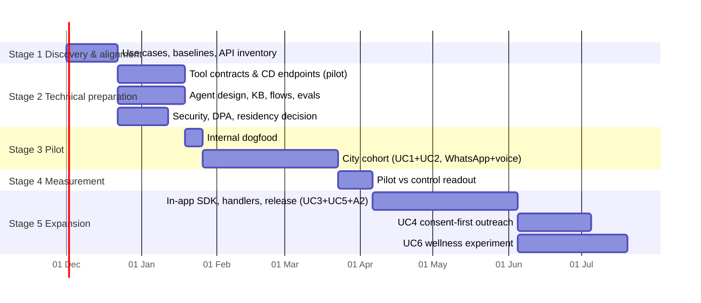

# Implementation Roadmap (Phase 9)

Durations are **planning assumptions**, not commitments; they depend on CD's API readiness (Q2) and release cadence (Q4).

| Stage | Activities | Deliverables | Graine | Country Delight | Dependencies |
|---|---|---|---|---|---|
| 1 Discovery & alignment (≈3 wks) | Validate problems with contact-reason data; confirm use cases; API inventory; baselines; success metrics; Ayuh orchestration decision | Agreed pilot scope, metrics, baseline | PM, solution architect | Product, support ops, tech lead, legal | Data access |
| 2 Technical preparation (≈4 wks) | Tool contracts; CD endpoints; flow agents; knowledge base from approved policy; verification method; security config; evals; WhatsApp setup; DPA; residency | Pilot-ready agents, test report | Agent engineers, QA | Back-end engineers, telephony, marketing (WABA), DPO | Q2, Q6, Q7 |
| 3 Pilot (≈1 + 8 wks) | Dogfood; controlled cohort; weekly evals; daily monitoring 4:30–9:30 AM | Live pilot, weekly report | Ops on call, tuning | Support ops escalation owner | Kill switch |
| 4 Measurement (≈2 wks) | Pilot vs control; customer behaviour; operational and financial impact | Readout; go/redesign/stop | Analyst | BI, finance | Baseline |
| 5 Expansion (≈3–5 months) | In-app SDK (UC3, UC5, A2), components, friction rules; UC4 with consent; UC6 experiment; more cities and languages | Phase 2/3 launches | Full team | Mobile team, catalogue (nutrition data), marketing | App release; nutrition data |

**RACI highlights:** CD owns policies, APIs, app releases, consent, customer communication; Graine owns agent design, platform operation, evals, monitoring and the weekly quality report; jointly own metrics and the go/no-go.
