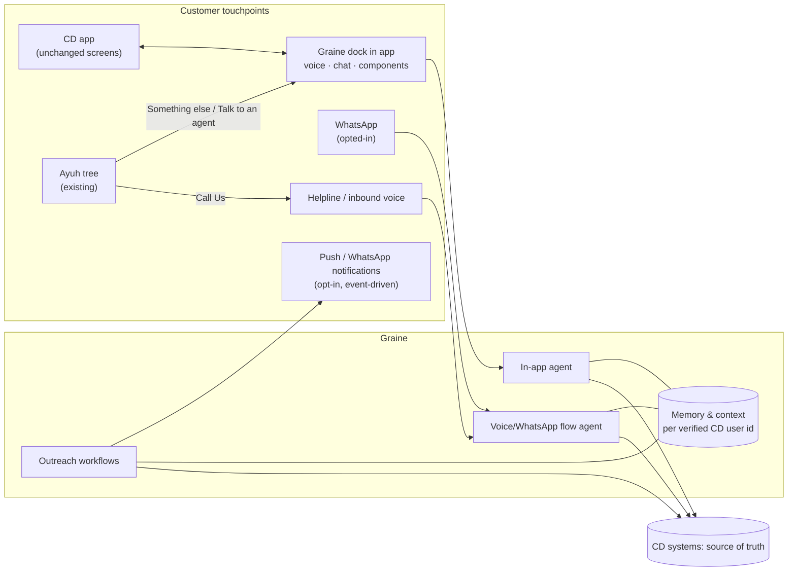
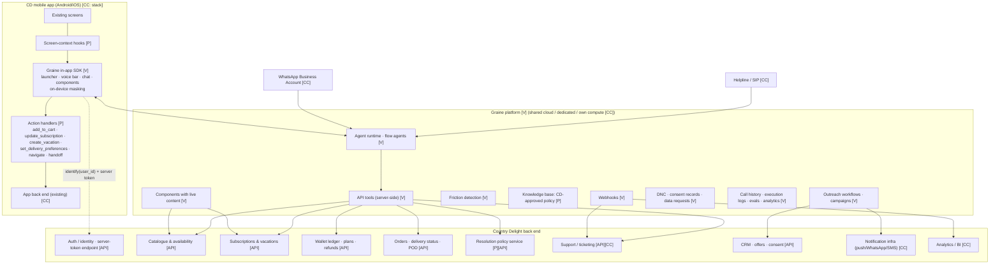

# Product Strategy & Solution Architecture

## 1. Product vision

> **"Say it, see it, done, with Country Delight's rules on every answer."**
> An intelligent assistance layer that lets every household understand its money, fix a bad morning, and change its daily order in its own words, while the app it already likes stays exactly as it is.

This refines the brief's starting vision ("an intelligent, personalised commerce experience…"). The research points to **trust and control in a subscription relationship** rather than discovery-led commerce as the first source of value (Executive Findings 1–4). Personalised discovery (UC6) and outreach (UC4) follow once trust is earned.

**Strategic pillars**

| Pillar | Customer promise | Use cases | Evidence |
|---|---|---|---|
| Understand my money | "I always know why my balance changed." | UC1, A1 | N03/N04, EV-026 |
| Fix my morning | "Someone helps at 5:30 AM, and it's sorted." | UC2, A3, A4 | N06/N09, EV-001/002 |
| Change my order in a sentence | "Tell it, see it, confirm it, undo it." | UC3, UC5, A2 | N10, P05 |
| Discover what's right for me | "Products that fit my goals and allergies." | UC6 | EV-036 |
| Hear only what's relevant | "Offers I asked for, when I want them." | UC4 | N13 (risk) |

## 2. Experience architecture

**Cross-channel continuity** (subject to identity resolution and consent): a customer who reports a missing item on WhatsApp at 5:40 AM and later opens the app sees the same case ID in the dock, because both agents key memory to the same CD user id (Graine memory via `identify()`; EV-046). The voice/WhatsApp agent and the in-app agent are **separate agents** sharing a knowledge base, not a tool list (Graine "one agent per surface").

**Coexistence with Ayuh (PR-001).** Ayuh stays the visible help entry. Its "Something else" and "Talk to an agent" branches open the Graine agent with Ayuh's selected path as context; "Call Us" can route to the Graine inbound line out of hours. *Requires CD agreement on orchestration and Ayuh's ownership (Q3).*

## 3. Technical architecture

Labels: **[V]** Verified capability (Graine docs/recordings) · **[P]** Proposed design · **[API]** Requires a Country Delight API · **[CC]** Requires client confirmation.

### Integration status table

| Integration | Purpose | Status |
|---|---|---|
| Graine SDK in CD app | Dock, voice/chat, components, actions | [V] capability · [CC] stack & release |
| Screen context | Agent knows the screen | [P] CD implements hooks |
| Action handlers | Execute changes through CD's app session | [P] CD implements; [API] behind them |
| API tools (server) | Read ledger, orders, subscriptions, catalogue | [V] mechanism · [API] endpoints |
| Components with live data | Subscription card, product list, wallet card | [V] mechanism · [API] HTTPS read endpoints |
| Identity | Verified user before account data | [V] server tokens · [API] CD token endpoint |
| Inbound voice | Helpline / out-of-hours | [V] · [CC] number routing / SIP |
| WhatsApp | Calling [V]; workflow messages [V]; two-way text agent [CC with Graine] | Mixed |
| Ticketing | Case creation, handoff | [API][CC] system name |
| Resolution policy | Which remedies are allowed | [P][API]: rules owned by CD |
| Notifications | Opt-in exception alerts | [CC] |
| Analytics | Pilot measurement | [V] Graine analytics + webhooks · [CC] CD BI |

## 4. Agent design

| Agent | Surface | Type | Tools | Notes |
|---|---|---|---|---|
| **CD Help (voice/WhatsApp)** | Helpline, WhatsApp | Flow agent: identity → intent → tools → resolution → close | read tools + `create_support_ticket`, `request_resolution`, `request_wallet_refund`, `set_delivery_preferences`, `handoff_to_human` | Pilot. Hindi/English/Hinglish + regional. Fixed lines for disclosure and verification. |
| **CD In-app assistant** | App dock | Prompt agent with flow steps for T2/T3 | 11 in-app actions + server API tools + components | Phase 2 |
| **CD Offers** | Workflow | Flow agent, disclosure-first | `list_eligible_offers`, components | Phase 3; consent-gated |
| **CD Wellness** | In-app section | Flow agent with safety step | `save_wellness_profile`, `recommend_products` | Phase 3; experiment |

**Grounding rules for every agent:** answers about money, orders, subscriptions and offers come only from tool results; policy answers come only from the CD-approved knowledge base; if neither has the answer, the agent says it does not know and offers a person.
