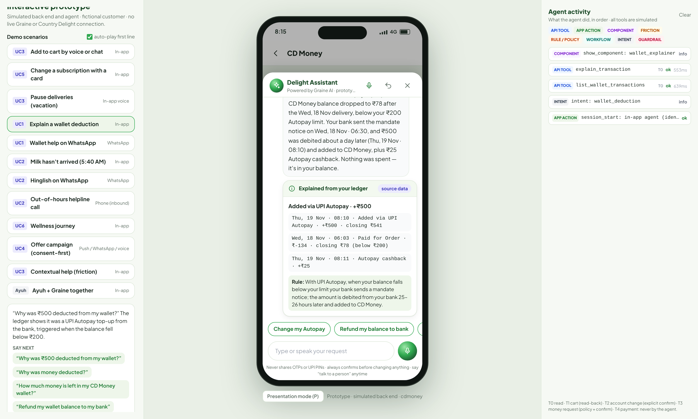

# Prototype — Country Delight app with a Graine AI assistance layer

An interactive, presentation-ready prototype of the Country Delight app with the proposed Graine agent: in-app chat and voice, WhatsApp and phone-call simulators, and a presenter shell that launches every use case and shows every tool call.

> **Simulated, not connected.** The Country Delight back end, the agent's language understanding and the channels are simulated locally. No Graine agent, Country Delight system, WhatsApp account or phone line is connected. The customer, address, prices and offers are fictional or illustrative. The prototype shows the *intended experience and controls*, not production readiness.



## Run it

Requires Node 18+ (tested on Node 22).

```bash
cd 06_Prototype/Source_Code
```

```bash
npm install
```

```bash
npm run dev
```

Open http://localhost:5173. For a meeting, build once and serve the static build (works offline except the web font):

```bash
npm run build && npm run preview
```

Then open http://localhost:4173 (`?present` opens presentation mode).

| Layout | What you see |
|---|---|
| Desktop ≥ 1280 px | Scenario launcher · phone · agent-activity inspector |
| Laptop 700–1280 px | Phone + buttons that open the scenarios / inspector drawers |
| Phone < 700 px | Full-screen app; a floating **Demo** button opens the drawers |
| Presentation mode (**P** or `?present`) | Phone only, centred |

## Demo scenarios (left panel)

| # | Use case | What to show | Start line (auto-played) |
|---|---|---|---|
| 1 | UC3 | Add to cart, with clarification and cart read-back | “Add two packets of milk to my cart.” |
| 2 | UC5 | Subscription change card: now → new, effective date, price, offer impact, Confirm, Undo | “I want to add one more packet of milk to my regular subscription.” |
| 3 | UC3 | Voice: pause deliveries, rule-checked dates, on-screen confirmation | “Pause my delivery for the next three days” |
| 4 | UC1 | Explain a ₹500 deduction from the ledger (Autopay top-up) | “Why was ₹500 deducted from my wallet?” |
| 4w | UC1 | Same agent on WhatsApp | “Why was ₹500 deducted?” |
| 5 | UC2 | 5:40 AM, order marked delivered: proof of delivery, policy options, case ID | “My milk hasn't arrived.” |
| 5w | UC2 | Hinglish on WhatsApp | “mera doodh abhi tak nahi aaya” |
| 5c | UC2 | Out-of-hours helpline call with identity check | tap the suggested lines |
| 6 | UC6 | Wellness: consent, goal, diet, allergy, allergen-safe suggestions, bundle | “I have started working out. Recommend products.” |
| 7 | UC4 | Campaign console: per-channel eligibility (consent, DNC, cap, window), push → offer → STOP | use the three buttons |
| 8 | UC3 | Friction: open Set Vacation and wait 20 s → one quiet suggestion | — |
| 9 | Ayuh | Ayuh tree kept; hand over to the assistant with context | — |

**Controls:** Reset data · Restart chat · Home · demo clock (before / after the 11 pm cut-off, 5:40 AM delivery window, 11 AM campaign window) · *Fail next tool call* (fault injection) · *Slow network* · *Speak replies*.

**Inspector:** every intent, API tool, in-app action, component, rule check, friction signal, workflow step and guardrail, with tier (T0–T4), latency and arguments.

## Free-form things to try

“How much money is left in my CD Money wallet?” · “Why was ₹999 deducted?” (not invented) · “Refund my wallet balance to my bank” · “Please don't ring the bell” · “Stop my curd” (save flow) · “Change my coconut water to daily” (offer-void warning) · “Add paneer every Sunday” · “Any offers for me?” · “I have diabetes, what should I eat?” (safety) · “I want to talk to a person” · “kal se 3 din doodh band kar do”.

Voice uses the browser's Web Speech API (Chrome or Edge; microphone permission). Where it isn't available, tap-to-speak phrases simulate it.

## What is real vs simulated

| Part | In this prototype | In production |
|---|---|---|
| App screens | Re-created from the recorded app (v10.9.100), original illustrations | Country Delight's app, unchanged |
| Agent understanding | Rule-based English/Hinglish parser (`src/agent/nlu.ts`) | Graine model runtime |
| Agent orchestration | `src/agent/engine.ts` (flows, tiers, guardrails) | Graine flow agents / prompt agents |
| Tools | `src/backend/api.ts` against a local store | Graine API tools + CD back-end endpoints; in-app actions via the Graine SDK |
| Business rules | `src/backend/rules.ts`: 11 pm cut-off, 60-day vacation, charge after delivery, Autopay lag, refund rules (from CD's public FAQ/app); resolution policy is a **prototype policy** | CD's rule and policy services |
| Voice | Browser speech recognition and synthesis | Graine voice stack |
| WhatsApp / calls | UI simulators | Graine WhatsApp / telephony with CD's accounts and numbers |
| Persistence | `localStorage` (reset in the panel) | CD systems of record |

## Code map

```
Source_Code/
  src/data/        types, catalogue (illustrative prices), seed (fictional customer, consistent ledger)
  src/backend/     rules.ts · api.ts (simulated tools) · store.ts (persisted state, inspector log)
  src/agent/       nlu.ts · engine.ts (conversation engine)
  src/agent-ui/    AgentSheet + Dock · Cards (conversational components) · VoiceOverlay · Channels (WhatsApp, call) · voice.ts
  src/screens/     Shop (Home, Products, Product, Cart) · Account (Subscriptions, Edit, Vacations, CD Money, Transactions, Orders, Account & Preferences, Menu, Offers, History) · Wellness · Ayuh
  src/demo/        scenarios.ts · Panels (scenario launcher, controls, inspector)
  tests/unit/      62 tests: NLU, dates, rules, all six scenarios, guardrails
  tests/e2e/       19 Playwright tests through the real UI; screenshot capture
```

## Checks

```bash
npm run typecheck && npm test
```

```bash
npm run build && npm run test:e2e
```

Latest results: [Test_Results.md](Test_Results.md).
